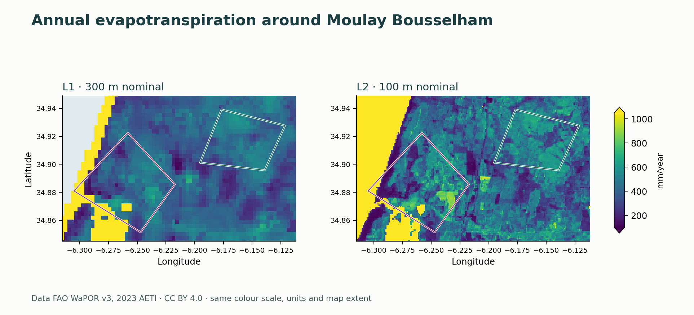
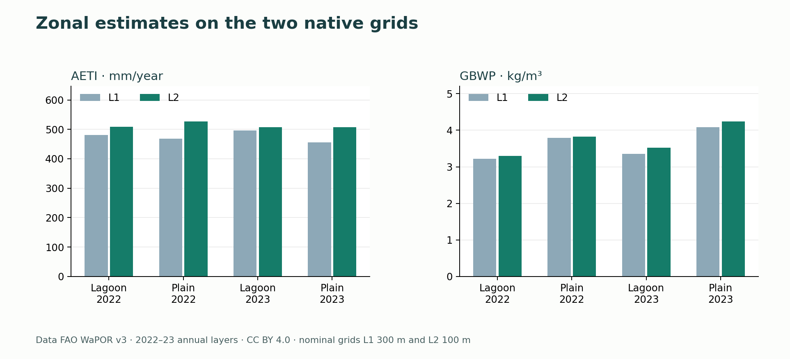
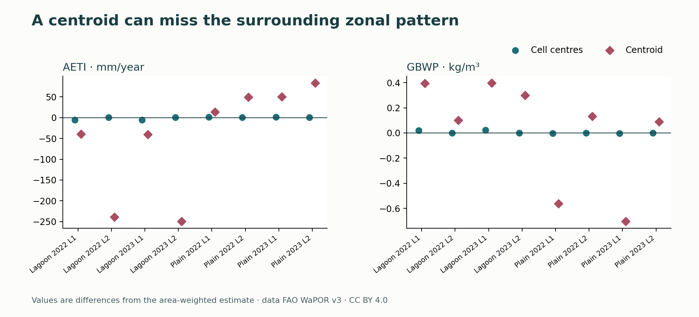
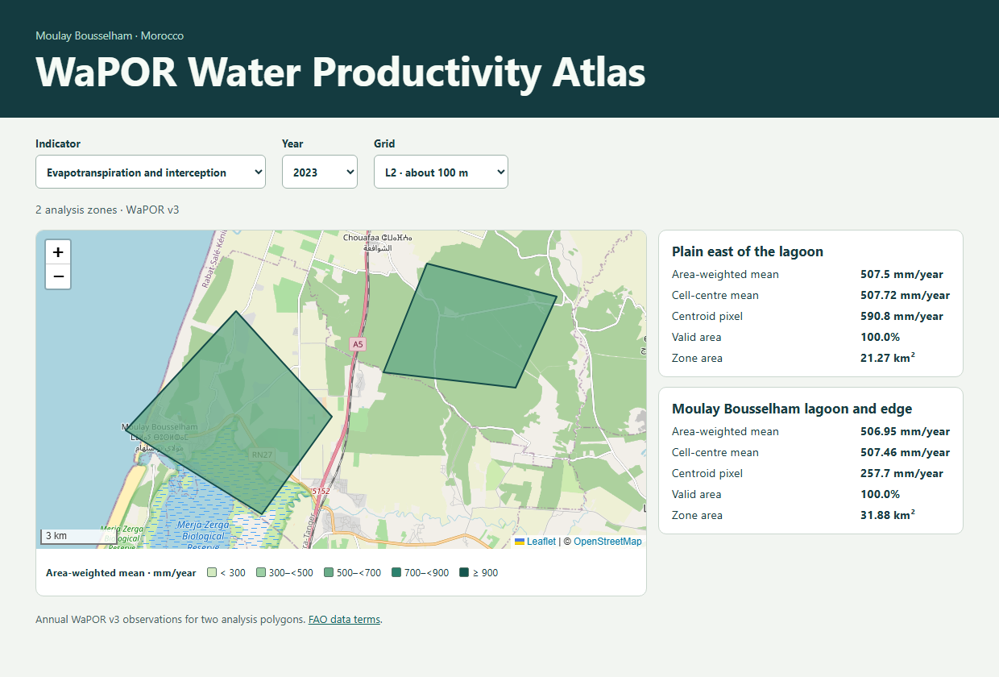

# WaPOR Water Productivity Atlas

Compare the FAO WaPOR v3 annual estimates near Moulay Bousselham, Morocco, at two native grid resolutions. The atlas measures how the statistic changes when it uses each intersected pixel's area, assigns equal weight to pixels whose centres lie in the zone, or uses the value of the centroid pixel.

## Source and methods

The analysis covers two study polygons drawn for the experiment. Their areas are 31.88 km² and 21.27 km². The source is eight revision-pinned COGs for actual evapotranspiration and interception (AETI) and gross biomass water productivity (GBWP) in 2022 and 2023. Rasterio reads only a small bounding window from each public object. The manifest records the source generation, object size and SHA-256 of each local subset.

The inputs have WGS84 longitude and latitude. The nominal 300 m L1 grid has a 0.0029296875° spacing and the nominal 100 m L2 grid has a 0.0009765625° spacing. Pixel extents and zones are projected to EPSG:6933 before intersections. Valid-area coverage divides the matching area by the full polygon area. Missing pixels and negative values are excluded. The scale is 0.1 mm/year for AETI and 0.001 kg/m³ for GBWP. The GBWP aggregate is an area-weighted mean of pixel-level ratios.

~~~mermaid
flowchart LR
    A[FAO COG revisions] --> B[Small Rasterio windows]
    B --> C[Equal-area pixel intersections]
    C --> D[PostGIS and SQL check]
    D --> E[GeoJSON and Leaflet]
    B --> F[Native QGIS project]
~~~

## Measured results

| 2023 study zone | AETI L1 | AETI L2 | GBWP L1 | GBWP L2 |
| --- | ---: | ---: | ---: | ---: |
| Lagoon and edge | 496.89 mm/year | 506.95 mm/year | 3.359 kg/m³ | 3.522 kg/m³ |
| Inland plain | 455.20 mm/year | 507.50 mm/year | 4.081 kg/m³ | 4.238 kg/m³ |

In the lagoon zone on the 2023 L2 grid, the centroid gives 257.70 mm/year and the area-weighted mean gives 506.95 mm/year. The valid-area fraction is at least 99.99% across all sixteen estimates. The numerical differences combine resolution and the WaPOR processing at each level. The estimates cover two selected areas and two years. They include water and mixed land cover. The study evaluates remotely sensed AETI and GBWP rather than field measurements.

PostGIS independently intersected 25,976 valid cells and matched all sixteen Python summaries within 8 × 10⁻¹² in the corresponding physical units. Loading the same snapshot twice yielded identical zonal summaries. [Source manifest](reports/source-manifest.json) · [Zonal results](reports/zonal-results.json) · [PostGIS checks and local query timings](reports/postgis-check.json)

## Reproduce

Install Python 3.13, Docker with Compose, and the Python requirements. In PowerShell, set a local database password as the `ATLAS_DB_PASSWORD` environment variable and keep it for later runs with the same database volume.

~~~powershell
python -m pip install -r requirements.txt
python fetch_wapor.py
python -m unittest discover -s tests -v
docker compose up -d --wait database
python load_atlas.py
python plot_results.py
python serve.py
~~~

Open the [local atlas](http://127.0.0.1:8043/). Switch the year, grid and indicator to query one of eight GeoJSON views. Internet access is used for the Leaflet library and OpenStreetMap background tiles. The analytical layer and zonal values come from the local database.

With the checked sources in place, open the [QGIS project](atlas.qgs). The project was generated and re-opened with QGIS 3.40.6. Its relative paths load four 2023 rasters and one layer with the two polygons. Use `prepare_qgis.py` in the QGIS Python runtime to regenerate it. Run `docker compose down` to stop the atlas database and retain its local data.

FAO. 2026. WaPOR v3 annual AETI and GBWP, L1 and L2. Accessed on 18 November 2026. Adaptation and analysis of clipped raster windows. Licence CC BY 4.0 under the FAO database terms. [WaPOR access](https://www.fao.org/in-action/remote-sensing-for-water-productivity/wapor-data-access/en) · [FAO data terms](https://www.fao.org/contact-us/terms/db-terms-of-use/)
